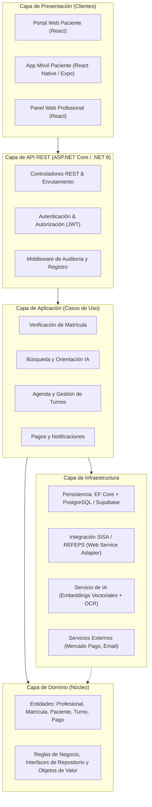

# Salud Directa 🩺

> **Trabajo Final Integrador (TFI)**  
> **Carrera:** Tecnicatura Universitaria en Programación  
> **Institución:** Universidad Tecnológica Nacional (UTN) — Facultad Regional Resistencia  
> **Carga Horaria Total:** 285 horas (95 horas por integrante)

---

## 👥 Datos del Equipo de Proyecto

| Apellido y Nombres | DNI | Legajo UTN Nº | Módulo / Rol Asignado |
| :--- | :--- | :--- | :--- |
| **Bosch Vesconi, Mateo** | 43.932.614 | 27976 | **Fullstack / Base de Datos** |
| **Zeniquel, Federico Emanuel** | 41.354.968 | 29239 | **Fullstack / Frontend (Web & Mobile)** |
| **Gerzel, Santiago Alan Gabriel** | 43.617.140 | 29474 | **Fullstack / API (Backend)** |

---

## 📌 Título y Descripción del Proyecto

**Salud Directa — Plataforma de vinculación entre profesionales de la salud particulares y pacientes sin cobertura médica**

### Breve Descripción y Contexto
El proyecto se orienta a dos colectivos que hoy no cuentan con un canal formal de vinculación entre sí:
1. **Profesionales de la salud matriculados y habilitados** por sus colegios o federaciones que ejercen de forma autónoma y atienden exclusivamente bajo la modalidad particular (sin convenios con obras sociales ni empresas de medicina prepaga): kinesiólogos, nutricionistas, fonoaudiólogos, psicólogos, odontólogos y médicos.
2. **Personas sin cobertura médica paga** que afrontan sus consultas de manera directa y desembolsan de su bolsillo.

### Problema que Resuelve
- **Opacidad de precios:** Desconocimiento del valor de la consulta hasta solicitarla, lo que impide comparar y deriva en la postergación de la atención.
- **Ausencia de verificación de credenciales:** Directorios basados en carga declarativa sin contrastación oficial contra registros de matrículas.
- **Visibilidad limitada del profesional autónomo:** Dependencia casi exclusiva del boca a boca al no integrar cartillas corporativas.
- **Gestión manual de la agenda:** Coordinación precaria por mensajería que genera superposiciones y ausentismo sin aviso.
- **Falta de previsibilidad en tratamientos prolongados:** Falta de presupuestos formalizados y seguimiento de paquetes de sesiones múltiples.
- **Ausencia de trazabilidad administrativa:** Inexistencia de un registro estructurado de turnos, pagos y comprobantes.

### Los Tres Pilares de la Solución
1. **Verificación de la matrícula** contra registros oficiales (**SISA / REFEPS**).
2. **Publicación obligatoria y anticipada de honorarios** de consulta y paquetes de tratamiento.
3. **Gestión estructurada de turnos y prestaciones** con pasarela de pagos integrada.

> [!IMPORTANT]
> **Exclusiones Explícitas del Alcance:**
> - **NO** se incluye teleconsulta ni atención médica remota (se enfoca en la atención presencial).
> - **NO** se incluye historia clínica electrónica ni registro de datos clínicos sensibles (solo gestión administrativa de turnos, cumpliendo con la Ley 25.326).
> - **NO** se incluye prescripción ni emisión de recetas médicas.
> - **NO** se incluye intermediación ni convenios con obras sociales o medicina prepaga.

---

## 🏛️ Módulos Funcionales del Sistema

1. **Registro y verificación del profesional:** Alta con datos de matrícula, verificación automatizada contra registros oficiales (REFEPS/SISA), validación asistida de documentación mediante OCR y distintivo oficial de profesional verificado.
2. **Perfil profesional y transparencia de honorarios:** Perfil público, publicación obligatoria del valor de la consulta con historial de actualizaciones y paquetes de tratamiento.
3. **Búsqueda y orientación del paciente:** Buscador con filtros combinables y orientación asistida por búsqueda semántica (lenguaje natural / embeddings) con advertencia explícita de no diagnóstico y derivación ante urgencias.
4. **Agenda y gestión de turnos:** Configuración de disponibilidad horaria, reserva en línea con control de concurrencia, ciclo de vida del turno (*solicitado, confirmado, cumplido, cancelado, ausente*) y recordatorios automáticos.
5. **Pagos y comprobantes:** Pago de seña o total mediante pasarela de pagos (Mercado Pago), gestión de paquetes de sesiones y políticas de cancelación/reintegro.
6. **Panel del profesional y reportes:** Indicadores clave de ocupación, ausentismo e ingresos, y exportación de planillas de cálculo.

---

## 🛠️ Stack Tecnológico

| Capa / Función | Tecnología Seleccionada | Justificación / Rol en el Proyecto |
| :--- | :--- | :--- |
| **Frontend Web** | React 19, Tailwind CSS, Vite | Portal responsivo y accesible para pacientes y profesionales. |
| **Frontend Móvil** | React Native con Expo | Aplicación móvil para pacientes. |
| **Backend / API** | C# / .NET 8 (ASP.NET Core Web API) | Implementación de Clean Architecture, reglas de negocio, endpoints REST y autenticación JWT. |
| **Base de Datos** | PostgreSQL / Supabase | Almacenamiento persistente relacional, transaccional y políticas Row Level Security (RLS). |
| **ORM** | Entity Framework Core | Mapeo objeto-relacional y acceso a datos tipado. |
| **Verificación Oficial** | Servicio Web REFEPS (SISA) | Consulta nominal de matrículas habilitadas ante el Ministerio de Salud. |
| **Procesamiento OCR** | Tesseract OCR | Extracción automática de datos de credenciales y títulos (PDF e imágenes). |
| **Inteligencia Artificial** | Embeddings / Base Vectorial | Búsqueda semántica para orientación asistida del paciente. |
| **Pasarela de Pagos** | Mercado Pago SDK | Cobro en línea de señas, consultas y paquetes de sesiones. |
| **Accesibilidad** | WCAG 2.1 (Nivel AA) | Contraste de colores $\ge 4.5:1$, navegación por teclado, focus visible y ARIA labels. |
| **Testing & Calidad** | xUnit, Oxlint | Pruebas unitarias de reglas de dominio ($\ge 70\%$ cobertura) y análisis estático. |
| **Gestión Ágil** | Jira & GitHub | Tableros Kanban individuales y general bajo marco Scrum. |

---

## 📐 Arquitectura de la Aplicación

El sistema adopta una arquitectura en capas basada en **Clean Architecture**:



---

## 📋 Requerimientos del Sistema

### Requerimientos Funcionales (RF)
- **RF-01:** Registro de profesionales de la salud con carga de matrícula, jurisdicción y profesión.
- **RF-02:** Verificación automatizada de matrícula contra registro oficial (SISA/REFEPS).
- **RF-03:** Carga de documentación respaldatoria y extracción automática de datos con OCR.
- **RF-04:** Distintivo oficial de verificación en perfiles con matrícula habilitada.
- **RF-05:** Exigencia obligatoria de publicación de honorarios de consulta para publicar perfil.
- **RF-06:** Definición de paquetes de tratamiento (cantidad de sesiones, precio total y condiciones).
- **RF-07:** Buscador con filtros combinables (profesión, especialidad, localidad, honorarios, accesibilidad).
- **RF-08:** Sugerencia de profesional asistida por lenguaje natural con advertencia explícita de no diagnóstico.
- **RF-09:** Configuración de disponibilidad horaria, duración de prestaciones y bloqueos por ausencias.
- **RF-10:** Reserva de turnos en línea con control estricto de concurrencia (evita doble asignación).
- **RF-11:** Gestión del ciclo de vida del turno (*solicitado, confirmado, cumplido, cancelado, ausente*).
- **RF-12:** Envío de recordatorios automáticos de turnos.
- **RF-13:** Procesamiento de pago de seña o total mediante integración con Mercado Pago.
- **RF-14:** Registro y seguimiento del avance de sesiones consumidas y pendientes en paquetes.
- **RF-15:** Panel para el profesional con métricas de ocupación, ausentismo e ingresos.
- **RF-16:** Exportación de turnos y cobros en formato de planilla de cálculo.

### Requerimientos No Funcionales (RNF)
- **RNF-01:** Cumplimiento estricto de la **Ley 25.326** de Protección de Datos Personales (consentimiento explícito y derecho de supresión).
- **RNF-02:** **No almacenamiento de datos clínicos ni diagnósticos de salud** (solo trazabilidad administrativa).
- **RNF-03:** Comunicaciones cifradas de extremo a extremo mediante TLS/HTTPS.
- **RNF-04:** Bitácora de auditoría inmutable para verificaciones, honorarios y pagos.
- **RNF-05:** Tiempo de respuesta del buscador $< 2$ segundos para el 95% de las consultas.
- **RNF-06:** Disponibilidad mínima del 99% en horario de atención.
- **RNF-07:** Interfaces accesibles bajo directrices **WCAG 2.1 Nivel AA**.
- **RNF-08:** Encapsulamiento del servicio de verificación para permitir incorporar nuevos padrones provinciales.
- **RNF-09:** Cobertura mínima del 70% en pruebas unitarias automatizadas sobre reglas de dominio.

---

## 🗓️ Planificación de Sprints y Cronograma

| Sprint | Período | Etapa | Historias Incluidas | Requerimientos | Entregable / Hito de Evaluación |
| :---: | :---: | :---: | :--- | :--- | :--- |
| **1** | 10/08 al 31/08 | 1 | Preparación técnica, arquitectura, prototipado en Figma, repositorios, modelo ER y base de datos. | RNF-08 | Entornos configurados y prototipos aprobados. **1º Evaluación (31/08)** |
| **2** | 31/08 al 15/09 | 2 | **HU1** (Registro y Login), **HU14** (Seguridad y Privacidad base). | RF-01, RNF-03, RNF-04 | API REST y autenticación operativas. **Tutoría (14/09)** |
| **3** | 16/09 al 28/09 | 2 | **HU2** (Matrícula SISA), **HU3** (OCR), **HU4** (Honorarios y Perfil). | RF-01 al RF-05, RNF-08 | Perfiles y verificación operativa. **2º Evaluación (28/09)** |
| **4** | 29/09 al 13/10 | 3 | **HU8** (Agenda), **HU9** (Reserva en Línea), **HU10** (Recordatorios). | RF-09 al RF-12 | Motor de turnos con control de concurrencia. |
| **5** | 14/10 al 30/10 | 3 | **HU5** (Paquetes), **HU6** (Buscador), **HU7** (IA), **HU11** (Mercado Pago), **HU12** (Seguimiento). | RF-06 al RF-08, RF-13 al RF-16 | Buscador, pagos y paquetes operativos. **Tutorías Finales** |
| **6** | 02/11 al 11/11 | 3 | **HU13** (Dashboard & Reportes), **HU14** (Cierre de seguridad), **HU15** (Auditoría WCAG 2.1 AA & QA). | RNF-01, 02, 05, 06, 07, 09 | Producto final probado y validado. **3º Evaluación (11/11)** |

---

## 💻 Puesta en Marcha del Proyecto

### 1. Clonar el repositorio
```bash
git clone https://github.com/MateoBoschVesconi/SaludDirecta.git
cd SaludDirecta
```

### 2. Instalar dependencias
```bash
npm install
```

### 3. Configurar variables de entorno (`.env`)
Crear un archivo `.env` basado en `.env.example`:
```env
VITE_API_URL=http://localhost:5000/api
VITE_SUPABASE_URL=tu_supabase_project_url
VITE_SUPABASE_ANON_KEY=tu_supabase_anon_key
```

### 4. Ejecutar el servidor de desarrollo
```bash
npm run dev
```

### 5. Calidad de código y compilación para producción
```bash
# Análisis estático y linter
npm run lint

# Generación del bundle de producción
npm run build
```

---

## ⚖️ Marco Legal y Normativo
- **Ley Nacional Nº 25.326** de Protección de los Datos Personales de la República Argentina.
- **Pautas de Accesibilidad para el Contenido Web (WCAG 2.1 - Nivel AA)** del consorcio W3C.
